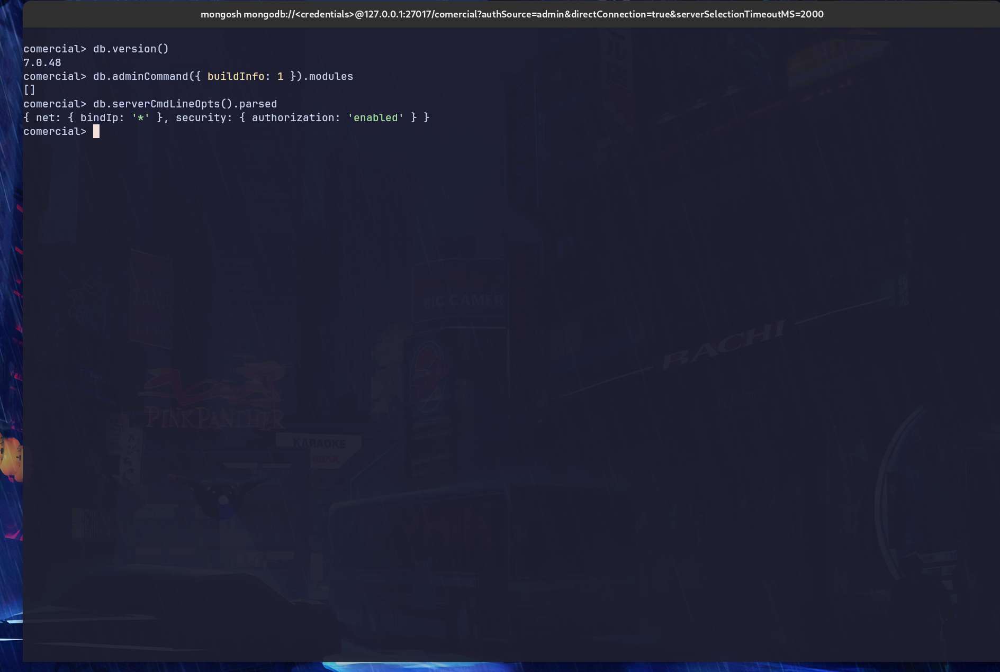

# Actividad 1: Lo que no existe en esta edición

## Comandos ejecutados y salida observada

## Respuestas a las preguntas

1. **¿Qué edición de MongoDB estás usando? ¿Qué evidencia lo demuestra?**  
   Se está utilizando **MongoDB 7.0.43 Community Edition**. La evidencia concluyente proviene del comando `db.adminCommand({ buildInfo: 1 }).modules`, el cual devuelve un arreglo vacío (`[]`). En MongoDB Enterprise Edition, dicho arreglo contendría explícitamente el módulo `"enterprise"`.

2. **¿A dónde escribe tu servidor su bitácora? ¿Cómo lo sabes?**  
   En la salida de `db.serverCmdLineOpts().parsed` se observa que no existe una sección `systemLog.destination: file` ni `systemLog.path` configurada explícitamente, por lo que el proceso `mongod` escribe su bitácora en la **salida estándar (`stdout`)** del proceso (comportamiento predeterminado en despliegues en contenedor o arranque directo sin archivo de configuración). Cuando se configura mediante archivo (`/etc/mongod.conf`), `db.serverCmdLineOpts().parsed.systemLog` muestra `destination: "file"` y la ruta exacta en `path` (por ejemplo, `/var/log/mongodb/mongod.log`).

3. **Según REF-U3-04, ¿qué cuatro categorías de eventos registraría la auditoría nativa?**  
   De acuerdo con la documentación oficial de MongoDB (REF-U3-04), la auditoría nativa disponible en Enterprise y Atlas registra:
   - **Cambios de esquema (DDL)** (creación o eliminación de bases de datos, colecciones e índices).
   - **Eventos de conjuntos de réplicas y clústeres fragmentados** (cambios de topología, elecciones de primario, adición/remoción de miembros).
   - **Autenticación y autorización** (inicios de sesión exitosos/fallidos, creación/modificación de usuarios y asignación/revocación de roles).
   - **Operaciones CRUD** (lecturas y escrituras sobre documentos, habilitando `auditAuthorizationSuccess: true`).

4. **¿Qué tendría que evaluar una organización antes de licenciar Enterprise o migrar a Atlas solo para obtener auditoría?**  
   - **Costo total de propiedad (TCO) y licenciamiento:** El costo de suscripción de MongoDB Enterprise Advanced o de clústeres Atlas M10+ frente al impacto financiero del riesgo regulatorio que se busca mitigar.
   - **Requisitos normativos y de cumplimiento:** Si regulaciones aplicables (PCI-DSS, HIPAA, ISO 27001, LFPDPPP) exigen trazabilidad inmutable de cambios de privilegios y lecturas que Community no puede cubrir.
   - **Impacto en desempeño y almacenamiento:** El volumen de eventos generados al activar `auditAuthorizationSuccess: true` y la infraestructura necesaria para almacenar y analizar los logs (SIEM).
   - **Complejidad operativa y arquitectura:** Costos de migración, capacitación del personal, latencia de red (en caso de migrar a nube con Atlas) y soberanía de datos.
