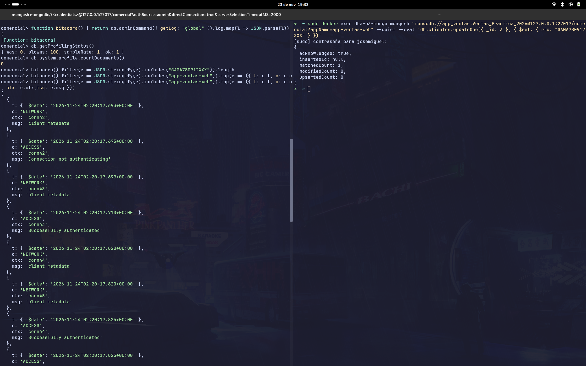

# Actividad 2: El incidente sin perfilado

## Ejecución y verificación

## Respuestas a las preguntas

1. **¿Puedes demostrar qué cambió? ¿Y quién se conectó a esa hora?**  
   - **Qué cambió:** **No.** Con el perfilador apagado (`was: 0`), `system.profile` tiene `0` documentos y la bitácora estándar de `mongod` no registra consultas ni operaciones de escritura ordinarias (`updateOne`). Aunque al consultar `db.clientes.findOne({ _id: 3 })` se vea el valor actual (`GAMA780912XXX`), no existe rastro en las bitácoras de qué operación lo modificó ni cuál era su estado anterior.
   - **Quién se conectó:** **Sí.** La bitácora JSON de `mongod` demuestra que a las `2026-10-25T22:52:34.661+00:00` la aplicación identificada como `app-ventas-web` se conectó y se autenticó exitosamente en el contexto `conn9` (usuario `app_ventas`). Sin embargo, solo se prueba la conexión, no la ejecución de la sentencia.

2. **¿Por qué `mongosh` abre varias conexiones (`conn8`, `conn9`, ...) para una sola instrucción? ¿Cuál es la que se autentica?**  
   El driver subyacente de Node.js que utiliza `mongosh` emplea un *pool* de conexiones y mecanismos de descubrimiento/monitoreo de topología (SDAM - *Server Discovery and Monitoring*). La primera conexión (`conn8`) se abre para realizar el *handshake* inicial (`hello`/`isMaster`), intercambiar metadatos del cliente y verificar el estado del servidor sin autenticarse (`Connection not authenticating`). Posteriormente, abre una conexión de trabajo (`conn9`) donde ejecuta el flujo de autenticación SCRAM (`Successfully authenticated`) para enviar la operación del usuario.
