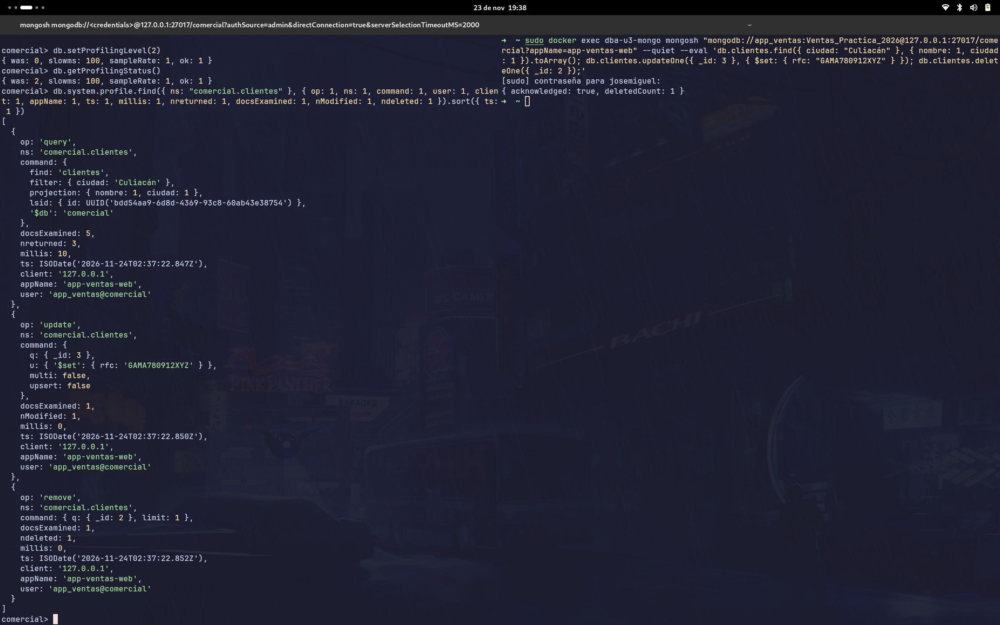

# Actividad 3: Activar el perfilador y registrar operaciones

## Ejecución y consulta de `system.profile`

## 9.1 Interpretación de los documentos registrados

| # | `op` | Usuario | Cliente | Aplicación | Momento (UTC) | Qué hizo | Documentos afectados |
|---|---|---|---|---|---|---|---|
| 1 | `query` | `app_ventas@comercial` | `127.0.0.1` | `app-ventas-web` | `2026-11-24T02:37:22.847Z` | Consultó clientes de `"Culiacán"` proyectando `nombre` y `ciudad` (`find`). | `docsExamined: 5`, `nreturned: 3` |
| 2 | `update` | `app_ventas@comercial` | `127.0.0.1` | `app-ventas-web` | `2026-11-24T02:37:22.850Z` | Actualizó el campo `rfc` a `"GAMA780912XYZ"` en el documento `{ _id: 3 }`. | `docsExamined: 1`, `nModified: 1` |
| 3 | `remove` | `app_ventas@comercial` | `127.0.0.1` | `app-ventas-web` | `2026-11-24T02:37:22.852Z` | Eliminó un documento con filtro `{ _id: 2 }` (`limit: 1`). | `docsExamined: 1`, `ndeleted: 1` |

## Respuestas a las preguntas

1. **¿Puedes saber cuál era el RFC antes del cambio con la información de `system.profile`?**  
   **No.** `system.profile` registra únicamente el comando recibido por el motor (`command: { q: { _id: 3 }, u: { $set: { rfc: 'GAMA780912XYZ' } } }`), es decir, el filtro de búsqueda y el nuevo valor asignado. No captura imágenes previas del documento (*before-image*), a diferencia de un disparador (`TRIGGER` con `OLD`) en PostgreSQL o Change Streams con `fullDocumentBeforeChange`.

2. **¿Puedes saber qué datos tenía el documento eliminado?**  
   **No.** El registro de `op: 'remove'` solo muestra el criterio de filtrado utilizado (`command: { q: { _id: 2 }, limit: 1 }`) y la cantidad de documentos eliminados (`ndeleted: 1`), pero no respalda el contenido del documento `{ _id: 2 }` antes de ser borrado.

3. **A diferencia de `log_statement = 'mod'` en PostgreSQL, el nivel 2 sí registró la consulta. ¿Qué ventaja y qué riesgo tiene eso?**  
   - **Ventaja:** Permite detectar accesos de lectura no autorizados, exfiltración de datos sensibles (como consultas masivas de RFC o correos) y diagnosticar consultas lentas que degradan el servicio.
   - **Riesgo:** Genera un volumen masivo de registros que degrada severamente el rendimiento de lectura/escritura, llena rápidamente el tamaño limitado de `system.profile` (1 MB por defecto) sobrescribiendo evidencia crítica, y expone datos sensibles en texto claro dentro de los predicados de filtro (`filter`) a cualquier usuario con permisos de lectura en `system.profile`.

4. **¿Por qué el campo `user` incluye `@comercial`?**  
   En MongoDB, los usuarios están vinculados a una base de datos de autenticación específica (`authSource`) donde fueron creados. El formato `<usuario>@<base_de_autenticacion>` (`app_ventas@comercial`) identifica de forma unívoca la identidad del usuario, evitando ambigüedades si existiera otro usuario llamado `app_ventas` definido en una base de datos distinta (por ejemplo, `app_ventas@admin` o `app_ventas@pruebas`).
