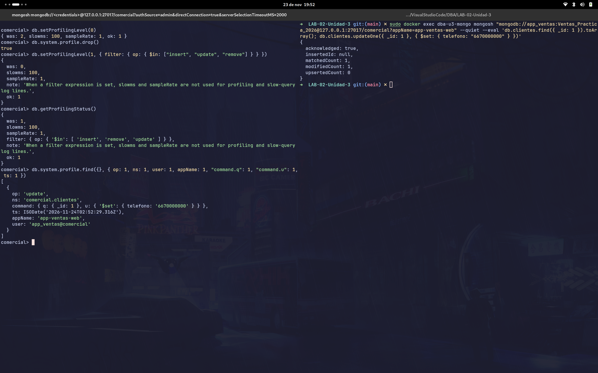

# Actividad 4: Reducir el volumen con un filtro

## Configuración ejecutada



## Respuestas a las preguntas

1. **¿Qué perdiste de evidencia al aplicar el filtro? ¿Qué ganaste?**  
   - **Qué se perdió:** Se perdió la visibilidad sobre todas las operaciones de lectura (`query`, `find`, `count`, `aggregate` de solo lectura) y comandos administrativos (`command`), así como el registro automático de consultas lentas basadas en `slowms` (ya que al establecer `filter`, MongoDB ignora los umbrales `slowms` y `sampleRate`). Ya no es posible saber si alguien consultó datos confidenciales sin modificarlos.
   - **Qué se ganó:** Se redujo drásticamente el volumen de escritura en `system.profile` y la sobrecarga de E/S del servidor. Al descartar las lecturas (que suelen representar más del 80-90% del tráfico de una aplicación web), se evita que la colección limitada de 1 MB se sature rápidamente, prolongando la retención temporal de los eventos de modificación (`insert`, `update`, `remove`).

2. **¿Qué filtro usarías si solo interesaran operaciones sobre la colección `clientes`?**  
   Se utilizaría un filtro sobre el espacio de nombres (`ns`, formato `<base>.<colección>`):
   ```javascript
   db.setProfilingLevel(1, { filter: { ns: "comercial.clientes" } })
   ```
   O, si se desean únicamente las modificaciones sobre dicha colección:
   ```javascript
   db.setProfilingLevel(1, {
     filter: {
       ns: "comercial.clientes",
       op: { $in: ["insert", "update", "remove"] }
     }
   })
   ```
