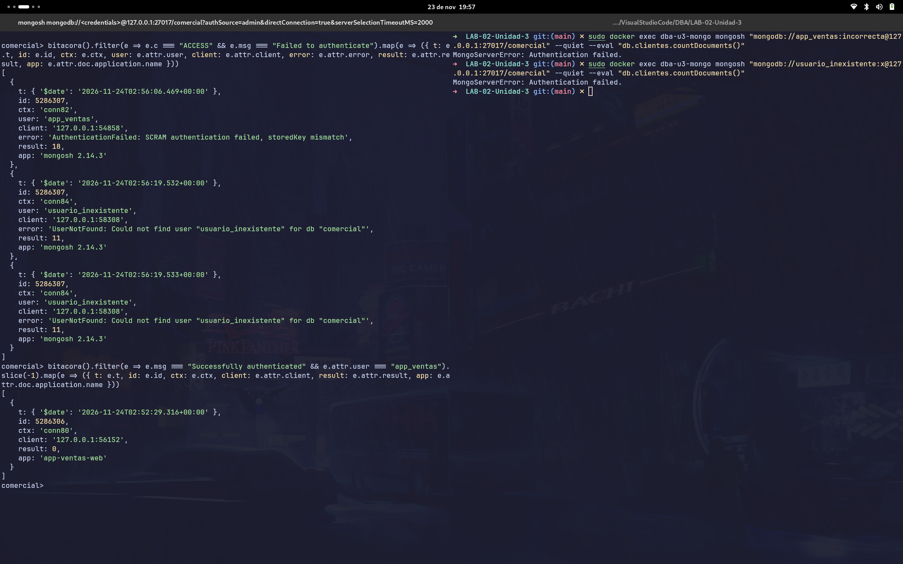

# Actividad 5: Accesos en la bitácora de `mongod`

## Eventos extraídos de la bitácora JSON

## Respuestas a las preguntas

1. **¿Qué campo distingue un acceso fallido de uno exitoso?**  
   Se distinguen principalmente por tres campos complementarios en el evento del componente `ACCESS`:
   - `msg`: `"Failed to authenticate"` para fallos vs. `"Successfully authenticated"` para éxitos.
   - `id`: `5286307` (autenticación fallida) vs. `5286306` (autenticación exitosa).
   - `attr.result`: Código de retorno distinto de cero (`18` para fallo de credenciales, `11` para usuario no encontrado) vs. `0` (éxito).

2. **¿Qué diferencia hay entre el error de contraseña incorrecta y el de usuario inexistente? ¿Por qué el cliente recibe el mismo mensaje en ambos casos?**  
   - **En la bitácora del servidor:** Cuando el usuario existe pero la contraseña falla (`app_ventas`), el servidor registra `Authentication Failed: SCRAM authentication failed, storedKey mismatch` (`result: 18`). Cuando el usuario no existe (`usuario_inexistente`), registra `UserNotFound: Could not find user "usuario_inexistente" for db "comercial"` (`result: 11`).
   - **En el cliente:** El cliente recibe en ambos casos el mensaje genérico `MongoServerError: Authentication failed.` como medida de seguridad contra la **enumeración de usuarios** (*user enumeration*). Si el servidor revelara al cliente si el usuario existe o no, un atacante podría descubrir nombres de cuentas válidas antes de lanzar un ataque de fuerza bruta.

3. **¿Por qué el nombre de la aplicación del intento fallido es `mongosh 2.14.3` y no `app-ventas-web`?**  
   Porque en la cadena de conexión utilizada para probar los accesos fallidos (`"mongodb://app_ventas:<REDACTED>@127.0.0.1:27017/comercial"`) se omitió el parámetro `?appName=app-ventas-web`. Cuando no se especifica `appName` en la URI de conexión, el driver envía por defecto el nombre y versión del cliente ejecutado (`mongosh 2.14.3`).
