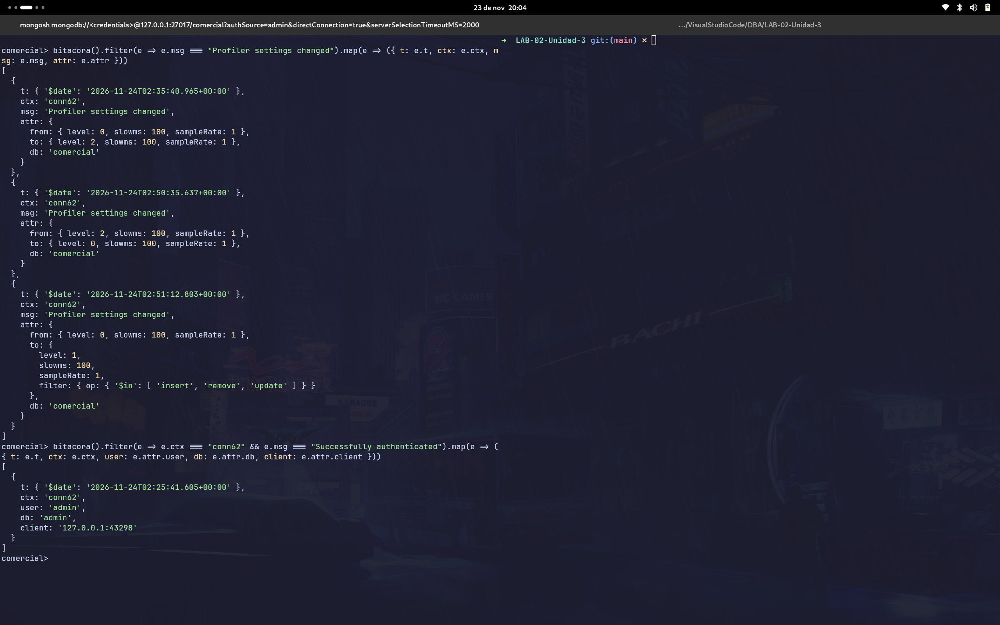

# Actividad 6: Correlacionar un cambio de configuración con su autor

## Eventos correlacionados mediante `ctx`

## Respuestas a las preguntas

1. **¿Qué usuario cambió la configuración del perfilador? ¿Qué dos eventos lo demuestran?**  
   El cambio fue realizado por el usuario **`admin@admin`** desde la dirección IP y puerto `127.0.0.1:43298`. Esto se demuestra al correlacionar dos eventos de la bitácora que comparten el mismo identificador de contexto (`ctx: 'conn62'`):
   - Primero, a las `2026-11-24T02:25:41.605+00:00`, el evento `"Successfully authenticated"` registra que el usuario `admin` (en la base `admin`) se autenticó en la conexión `conn62`.
   - Posteriormente, en esa misma conexión `conn62`, se registran los eventos `"Profiler settings changed"` (el último a las `2026-11-24T02:51:12.803+00:00`, cambiando el nivel de `0` a `1` con el filtro de operaciones de escritura en la base `comercial`).

2. **¿Qué condición debe cumplirse para que esta correlación sea válida?**  
   Ambos eventos deben pertenecer al **mismo ciclo de vida (ejecución continua) del proceso `mongod`**, sin reinicios entre la autenticación y la operación analizada, y dentro de una secuencia temporal coherente (la autenticación debe ser anterior al cambio). Si el servidor `mongod` se reinicia, el contador interno de conexiones vuelve a empezar desde `conn1`, por lo que `conn62` en un arranque distinto correspondería a una sesión y usuario completamente diferentes.

3. **¿Por qué es relevante que quede registrado un cambio de configuración del propio mecanismo de registro?**  
   Porque desactivar o alterar los filtros del perfilador (`level: 0`) es una técnica clásica de **evasión de defensa / borrado de huellas** empleada por atacantes o usuarios internos malintencionados antes de ejecutar acciones no autorizadas. Tener constancia de quién y cuándo apagó o modificó el registro permite detectar manipulación de la trazabilidad y acotar ventanas de ceguera operativa.