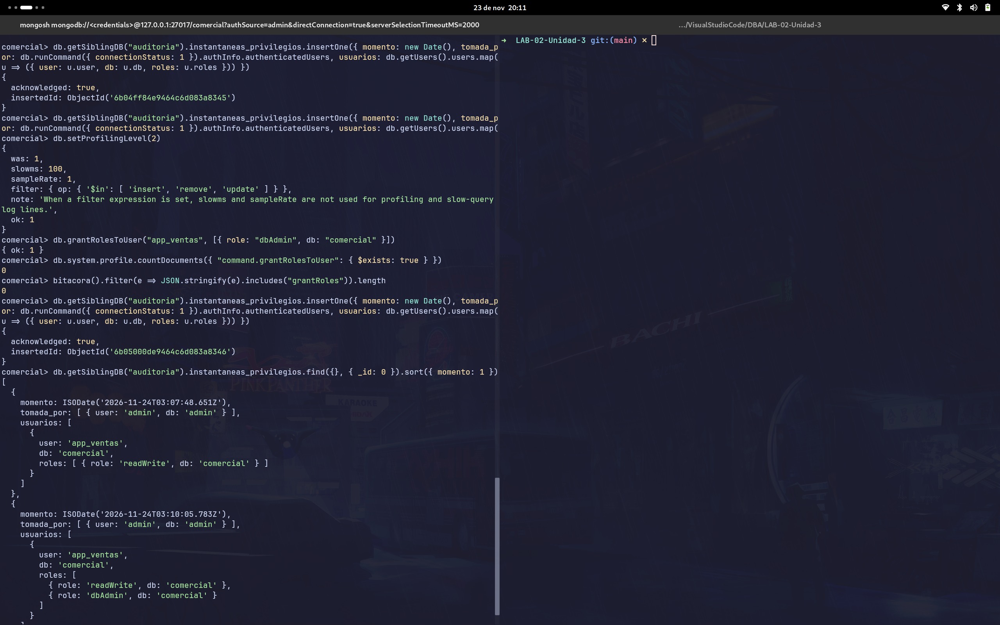
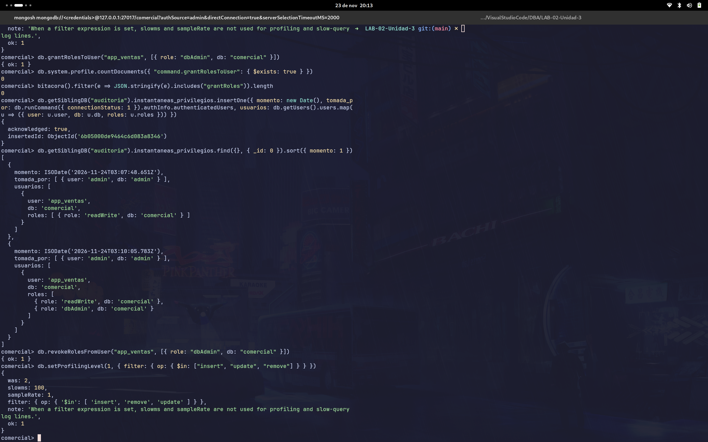

# Actividad 7: Cambios de privilegios — el límite más importante

## Prueba de ausencia de registro nativo y aplicación de instantáneas

## Respuestas a las preguntas

1. **¿Por qué un cambio de privilegios es uno de los eventos auditables más importantes?**  
   Porque constituye una **escalada de privilegios**. Si un usuario de aplicación como `app_ventas` recibe roles administrativos (`dbAdmin` o `root`), adquiere la capacidad de modificar esquemas, eliminar colecciones, alterar configuraciones de perfilado o crear nuevos usuarios administradores, comprometiendo por completo la confidencialidad, integridad y disponibilidad de la base de datos.

2. **¿Con qué frecuencia tomarías instantáneas? ¿Qué factores influyen?**  
   En un entorno productivo sin auditoría nativa, tomaría instantáneas automatizadas **cada 5 a 15 minutos** (mediante un *cron job* o tarea programada que compare el estado actual contra la última instantánea y dispare una alerta si hay diferencias). Los factores que influyen son:
   - La criticidad y sensibilidad de los datos almacenados (PII, datos financieros).
   - El tiempo máximo aceptable de detección (*MTTD - Mean Time To Detect*) ante una escalada no autorizada.
   - La frecuencia esperada de cambios legítimos de administración de usuarios.

3. **¿Quién debería poder escribir en `auditoria.instantaneas_privilegios`?**  
   Únicamente una **cuenta de servicio dedicada y automatizada** con privilegios mínimos (solo `insert` sobre `auditoria.instantaneas_privilegios` y lectura de usuarios, sin permisos de `update` ni `delete` sobre esa colección). Ni siquiera los desarrolladores ni los usuarios de aplicación deben tener acceso, e idealmente las instantáneas deben replicarse fuera del servidor (a un repositorio externo o SIEM) para evitar que un DBA con rol `root` pueda alterarlas.

4. **Redacta en tres líneas cómo comunicarías esta limitación a Dirección.**  
   MongoDB Community Edition no registra de forma nativa qué usuario otorga o revoca privilegios administrativos ni en qué instante exacto ocurre. Como control compensatorio implementamos instantáneas periódicas de permisos que detectan cualquier cambio entre intervalos y alertan al equipo de seguridad. Para obtener atribución individual exacta e inmutable de cambios de roles, se requiere evaluar la migración a MongoDB Enterprise o Atlas.